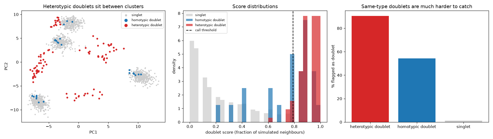

# scRNA-seq Doublet Detection

> That rare "transitional" cell type expressing T-cell and B-cell markers is probably two cells in one droplet.

## Demo Output

Produced from simulated single-cell counts by `demo.py`: where doublets land in PCA space, the doublet-score distributions, and which kinds of doublet get caught.

## Why This Exists

Droplet single-cell methods put two cells in one droplet a few per cent of the time, and the rate climbs as you load more cells. Doublets look like intermediate states, rare populations or "co-expressing" cells. In other words, they look like exciting biology. Scrublet's idea is simple and clever: make fake doublets by adding random pairs of real cells, embed everything together, and flag real cells whose neighbourhoods are full of fakes. This repo implements that idea in about 40 lines so you can see each step.

## How It Works

1. Simulate doublets by summing the raw counts of random cell pairs (2x as many as real cells).
2. Log-normalise, scale and run PCA, fitted on the real cells only.
3. For each real cell, find its k nearest neighbours among real + simulated cells.
4. Score = fraction of those neighbours that are simulated doublets.
5. Flag the top `expected_rate` of cells (about 0.8% per 1,000 cells loaded on 10x Chromium).

## What It Can and Can't See

| Doublet type | Detectable? | Why |
|--------------|-------------|-----|
| Heterotypic (two different types) | Yes | Mixed profile lands between clusters, where the fakes are |
| Homotypic (same type) | Partly, unreliably | Looks like a deeper-sequenced singlet. Here they're caught only because summing two cells smooths counting noise; real cells vary more |
| Doublets of a rare type | Partly | Too few fakes are made from rare cells |

## When NOT to Use This

- **Before basic QC.** Empty droplets and dying cells distort the embedding. Filter them first.
- **Pooled multi-sample runs.** Demultiplex first. Genotype-based demultiplexing catches cross-sample doublets for free.
- **Production pipelines.** Use Scrublet, scDblFinder or DoubletFinder. This repo is for understanding them.

## The Uncomfortable Truth

No expression-based method finds homotypic doublets reliably. Watch for cells with about twice the UMIs of their cluster, and remember your doublet rate is a floor, not an estimate.

## Further Reading

- Wolock S. L., Lopez R. & Klein A. M. "Scrublet: computational identification of cell doublets in single-cell transcriptomic data." Cell Systems (2019).
- McGinnis C. S., Murrow L. M. & Gartner Z. J. "DoubletFinder: doublet detection in single-cell RNA sequencing data using artificial nearest neighbors." Cell Systems (2019).
- Germain P.-L. et al. "Doublet identification in single-cell sequencing data using scDblFinder." F1000Research (2021).
